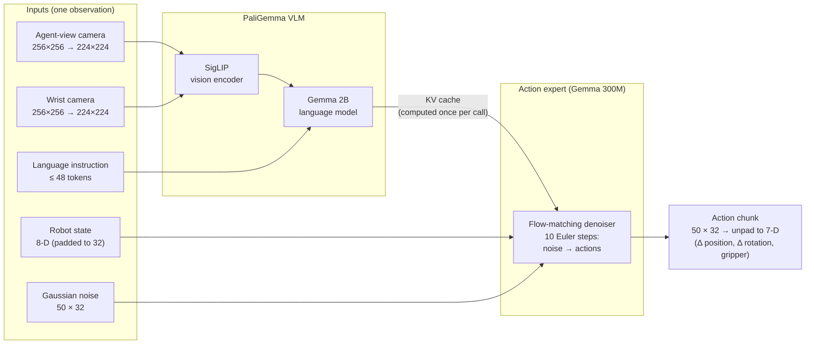
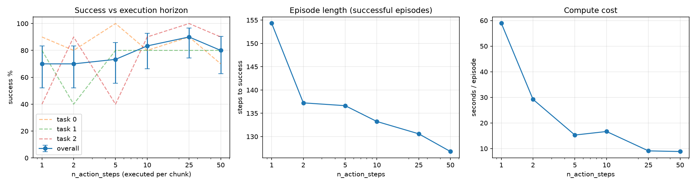

# VLA Action Chunking and RTC

How much of each predicted action chunk should a robot execute before replanning, and can
Real-Time Chunking remove the jerk at the switch between chunks? This repo experiments with π0 on the
LIBERO simulator and run on a single laptop GPU.

## Problem

Vision-language-action (VLA) models are slow: π0 has ~3B parameters and generates actions by
iterative flow-matching denoising. On the GPU one call takes **~0.29 s**, but LIBERO is
controlled at **20 Hz** (a new action every 50 ms). That means the robot moves about
**6 control steps during a single inference call**.

**Action chunking** hides this latency: the model predicts 50 future actions at once, the
robot executes the first `n_action_steps`, then replans. That creates two questions:

1. **How many actions should be executed per chunk?** Few means reactive but expensive and
   possibly inconsistent; many means cheap and smooth, but blind to changes.
2. **What happens at the chunk boundary?** A new chunk can start somewhere different from where
   the old one was heading, which is a sudden jump in the commanded action. **RTC** guides the
   denoising of the new chunk so that its start agrees with the actions already being executed.


What that looks like over time (one column ≈ one 50 ms control step, one π0 call ≈ 6 steps):

```text
1) Replan every step  (n_action_steps = 1)
   π0     ██████ ██████ ██████ ██████
   robot        a      a      a      a          robot idles ~6 steps for every action

2) Chunking  (n_action_steps = 10, synchronous)
   π0     ██████                ██████
   robot        A0 A1 ... A9          B0 ... B9  pause at every boundary,
                          └── jump ──┘           and B0 can be far from A9

3) Chunking + RTC  (asynchronous, inference delay d = 6)
   π0               ██████   ← call starts at the frame for A10
   robot  A0 ... A9 A10 ... A15 B6 B7 B8 ...     no pause: A keeps running during the call
                    └ B0..B5 ┘                   B0..B5 guided to match A10..A15,
                                                 so the switch A15 → B6 is smooth
```

Setting 3 is exactly what the boundary-jump experiment (Results §4) measures: the distance
between A15 and B6, with and without RTC.

## Setup

### Model architecture (π0)

**One-line flow:** `(agent-view cam + wrist cam + language instruction + robot state) → PaliGemma VLM [SigLIP vision encoder → Gemma-2B] → KV-cache (computed once) → Gemma-300M action expert → 10-step flow-matching Euler denoiser (noise → actions) → 50-step × 7-D action chunk → execute first n_action_steps, then replan (RTC steers the chunk boundary during denoising).`



The expensive part (the VLM) runs once per call. The action expert then refines random noise
into a full 50-step chunk in 10 steps. RTC acts only inside this denoising loop: at each step it
pulls the start of the new chunk toward the actions already committed from the previous chunk.

### How RTC guidance actually works

RTC does **not** simply blend or clamp the first actions after the chunk is produced. It modifies
the velocity field *during* each denoising step:

1. Compute the base velocity `v_t` from the action expert, then the predicted clean action
   `x1_t = x_t − t · v_t`.
2. Form the prefix error `err = (prev_chunk_left_over − x1_t) · weights`, where `weights` is a
   per-position mask from `get_prefix_weights(inference_delay, execution_horizon, chunk_size)`:
   **1.0** for the first `inference_delay` positions (hard-match the actions still being executed),
   decaying (LINEAR or EXP schedule) to **0** by `execution_horizon`, then **0** afterward (free
   generation). This is the "inpainting / prefix attention" view of chunk generation.
3. Back-propagate that error through the clean-action prediction with a vector–Jacobian product:
   `correction = ∂x1_t/∂x_t · err` (via `torch.autograd.grad`).
4. Scale it by a time-dependent `guidance_weight` (large early in denoising, decaying to 0, clamped
   at `max_guidance_weight`) and subtract: `v_guided = v_t − guidance_weight · correction`.

So RTC is **Jacobian-based guidance on the velocity field** (`mode="guided"`), not a post-hoc edit.


### Configuration

| | |
|---|---|
| Model | π0, `lerobot/pi0_libero_finetuned_v044` (bfloat16) |
| Framework | LeRobot 0.6.2, PyTorch 2.11 (CUDA 13) |
| Benchmark | LIBERO-Object, tasks 0–2, relative control mode, 280-step limit |
| Hardware | RTX 3080 Ti Laptop GPU (16 GB), peak usage ~10 GB |
| Timing | ~0.29 s per π0 call (compiled), ~0.05 s per simulator step |

The eval uses a fixed seed, so episode *k* of a task always starts from the same scene. All
settings are therefore compared on the same initial conditions.

## Results

### 1. Baseline

π0 on LIBERO-Object task 0 with `n_action_steps=10` (the OpenPI default):
**80% success (8/10), 95% Wilson CI 49–94%**, with a mean of 138 steps for successful episodes.
Both failures ran into the 280-step time limit.

### 2. Execution horizon sweep (closed loop)

30 episodes per setting (3 tasks × 10 episodes).



| `n_action_steps` | Success | 95% CI | Steps to success | Seconds / episode |
|---:|---:|---:|---:|---:|
| 1  | 70.0% | 52–83% | 154.3 | 58.9 |
| 2  | 70.0% | 52–83% | 137.2 | 29.2 |
| 5  | 73.3% | 56–86% | 136.6 | 15.3 |
| 10 | 83.3% | 66–93% | 133.2 | 16.7 |
| 25 | **90.0%** | 74–97% | 130.6 | 9.1 |
| 50 | 80.0% | 63–91% | **126.8** | **8.8** |

- **Replanning every step was the worst setting.** Success is lower (70% against 80–90% for
  10–50), but the confidence intervals overlap, so this is a trend rather than a proven
  difference at 30 episodes.
- **The clearest effect is on speed.** Steps to success fall steadily from 154 to 127 as more of
  each chunk is executed. Frequent replanning lets the policy switch between slightly different
  plans, so the robot hesitates.
- **Compute cost** grows about 6.5× from `n_action_steps=50` to `1`.
- LIBERO is static and has no disturbances, so the benefit of reacting quickly never shows up
  here, while the cost of inconsistency does.


### 3. Boundary jump: RTC off vs on

| Setting | Boundary jump | Prefix error |
|---|---:|---:|
| No RTC | 0.618 | 0.770 |
| horizon 10, weight 1 | 0.433 | 0.358 |
| horizon 10, weight 5 | 0.194 | 0.084 |
| **horizon 10, weight 10** | **0.161** | **0.017** |
| horizon 20, weight 10 | 0.149 | 0.016 |
| horizon 5, weight 10 | 0.391 | 0.071 |

- Without RTC the median jump is **4.3× a natural step**. With RTC (horizon 10, weight 10) it is
  **1.1×**, so the switch is almost as smooth as an ordinary step.
- RTC reduced the jump in **30/30 pairs** (median reduction 72%).
- **The guidance weight is the main setting.** Weight 1 is too weak, and weight 5 gets most
  of the benefit.
- **The execution horizon must be longer than the inference delay.** With horizon 5 and delay 6,
  guidance stops before the switch step, so the first executed action of B is unguided.
- RTC added about 7% to inference time in this test (0.29 s against 0.27 s, uncompiled).


## Next step: uncertainty-aware execution horizon

The best number of actions to execute per chunk is not fixed. In this project, the no-RTC
boundary jump alone varied by more than 10× across frames (0.13 to 1.5). That disagreement
between consecutive chunks is itself a measure of the model's uncertainty. An adaptive policy
could execute long chunks while consecutive predictions agree (or while several noise samples
agree), and replan sooner, with RTC to keep the transition smooth, when they diverge.
